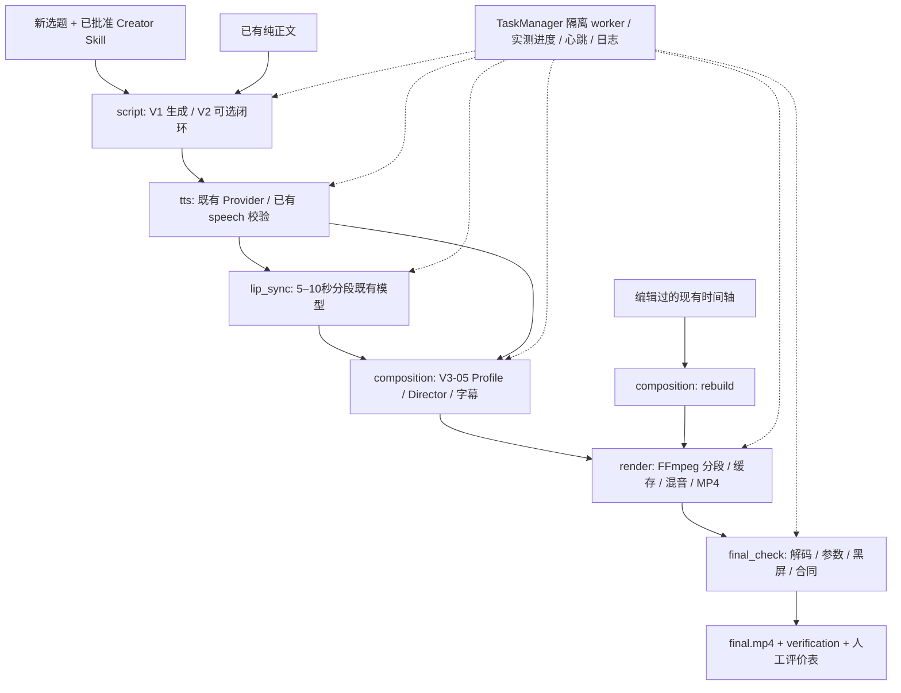

# CreatorDNA V3 完整架构（V3.0-06）

## 模块审计与最小集成

V1 的 Workflow/SkillManager/AgentRequest 提供只依赖独立已批准 Skill 的文案生成，V2 QualityWorkflow 提供评估、有限修订与人工反馈。V3.0-01 的 LocalVideoAnalyzer/VideoAssetWorkflow 提供真实媒体测量和可追踪资产库。V3.0-02 的 TaskManager/StageContext 提供隔离 worker、心跳、事件、原生 FFmpeg 进度、状态、取消、超时和检查点。V3.0-03 的 TTSProvider/synthesize_stage 提供音色授权、音频分段、收费 receipt 和 PCM 清单。V3.0-04 的 LipSyncProvider/prepare_task/generate_stage 提供授权、候选预留、模型 fingerprint、真实推理、技术检查。V3.0-05 的 ProductionWorkflow/AlignmentProvider/Video Director 提供语义编排、授权素材、ASS 与 video-timeline。

本阶段新增 video_workflow（编排薄层）、render（确定性本地媒体）、video_cli（统一入口）、严格工作流配置 Schema 和验收脚本。保留原 Provider 和 AI 合同，不引入动画框架、Web 应用或数据库。为复用口型准备逻辑，将原 create_task 的参数准备提取为 prepare_task，原公共入口行为保持兼容。

## 边界与合同

AI 只解释风格/文案/语义：文案输出沿用 generation Schema，评估沿用 V2 Schema，导演沿用 video-direction。路径、授权、哈希、音频/视频时长、字幕时间、候选使用与画幅由确定性代码检查。Creator Skill 独立可导出，不依赖渲染代码；视频不是 Skill 的组成部分。

工作流配置在读取时验证 video-workflow-config，随后由原 TTS/口型/生产合同再验证各部分。创建任务固定外部文件、Skill 版本与媒体哈希；执行前和编排后拒绝变更。已批准 Skill 被复制到 stage 输出内的私有工作区，AI 子运行与失败记录不会写回原始素材。声音凭证仅来自指定环境变量，配置和状态不保存密钥。

授权边界：音色沿用账户/端点范围的云处理授权；人物使用明确的本地生成范围声明，绑定实际生成 PCM 哈希后继续通过 V3-04 的 source/audio 双哈希合同。清单 unknown/denied 不可选。人物“技术完成”不表示人工身份或动作验收。源参考媒体只读，所有转码和运行文件在 workspace。

## 任务与恢复

状态合同继续使用 3.0-02，增加 script 阶段；旧阶段保留。实际执行为 script → tts → 可选 lip_sync → composition → render → final_check。只有 final_check 自动通过后才复制发布 final.mp4；render 的 candidate.mp4 明确未验收。运行中的整体进度只给已完成阶段数，不给阶段等权时间预测。心跳持续更新 elapsed；真实 Provider 报告和 FFmpeg out_time 写事件/日志，完成片段数也写 segments.json 和消息。状态未知时 percent=null。

每次 stage 尝试的 outputs 不可变；TaskManager 全量哈希后才发布检查点。resume 校验全部已完成成果，重新执行未完成的安全阶段。TTS 首先落盘 inflight，再保存 receipt；未知计费结果即阻止自动 POST，下载恢复为 GET-only，预算不重置。跨“新任务”不承诺全账户 TTS 去重：安全重执行应恢复原 task；重渲染完全绕过声音和口型。

口型音频按 25 fps 边界拆为 5–10 秒，每段沿用模型、授权、候选审核和预留账本；缓存保存准备参数、授权绑定、模型指纹、逐文件哈希及完成 receipt。失败后复用已完成段，保留原预留，拒绝混合不同模型结果。片段必须同一尺寸/帧率才能串接，不拉伸凑一致，不循环源动作。V3-04 的不兼容姿态 hook 在账本与分段 manifest 中保留，尚未自动转化为插入 B-roll 的强约束，应人工审核切口。

取消/超时由父进程停止整个 worker/FFmpeg/模型子进程树，保留凭据与失败产物。共享 GPU OS 锁沿用 V3-04。共享渲染缓存用 exclusive lock；中断残留锁不能由另一个运行任务偷取。clean 只面向已停止任务，不删除收费证据或完成成果；缓存清理要求没有运行任务。

## 画面与时间执行

从 profile 继承宽高、方向、SAR=1 和有理数帧率；自定义输出继续接受 V3-05 安全校验。解码应用视频显示旋转，图片在工作目录 EXIF 归一化。源 SAR 先还原显示比例，随后裁切源 crop，再等比 contain/cover 到 rect；anchor 控制水平裁切/对齐。背景先、前景后；alpha 保留，contain 补边遵守明确实色。字幕最后叠加 ASS；本地字体 fallback 仍需视觉审核。

整个片长使用一个全局 CFR 网格，按帧中点选中 [start,end) 片段，分段边界不能积累取整漂移。片段数由前/背景切点与最大秒长决定；检查实际帧数，不能默默丢帧或留下缺口。不同源/目标帧率终点可能需要最多一帧的正常末帧延展，不代表循环动作；音频时间不缩放。ASS 在每段使用全局 PTS 后还原到局部；fade 从片段开始按全局时间执行，分段不会重新淡入。基础转场为 cut/从 pad_color fade-in，暂不做跨片段 dissolve。

画面缓存 key 包含渲染器版本、几何、帧范围、媒体哈希、局部字幕/样式和编码参数；不包含主音轨/混音参数，音频变更只重混音。字幕关键词局部修改复用无关片段；全局字体/布局变化会改变相关全部 key。缓存只在 FFmpeg 成功且实际帧数正确后写 receipt。

片段 H.264 一致编码后 concat stream copy，主 PCM 独立映射成 AAC；视觉源音频静音。可叠加有授权/哈希/时间范围的音效或音乐，经 trim、volume、delay、amix 与峰值限制；不循环不足的声音素材。最终 faststart MP4 保存在新 attempt 内，拒绝覆盖。

## 自动验收与人工验收

自动层：时间轴 Schema、素材存在/授权/哈希/实测范围、前景覆盖、字幕正文/时间/安全区和 ASS 一致性；MP4 视频音频轨、实测时长/起点/帧数、尺寸、SAR、帧率、旋转；完整音视频解码及全片 blackdetect。非转场近黑画面（98% 像素，亮度阈值 0.10，持续至少 0.25 秒）阻止发布；合法黑色主题画面也可能触发，应修订或人工核对，不静默关闭检查。黑屏检测不能证明语义素材未重复，也不能保证烧录字幕位置正确。

人工层独立为 pending：人物身份/外貌、自然声音、口型感知同步、动作重复、B-roll 含义、字幕清晰度和整体参考风格。不会把 fixtures、真实参考原声重渲染或解码通过作为新 TTS/口型的质量证据。真实 Level 1–3 逐级新生成并验收技术参数，性能记录为实际耗时/文件字节数/Provider metrics；真实成本需账单，CPU/RAM 峰值统一采集留待后续。

## 已知边界与后续

当前缺真实云凭证、注册授权音色和准备好的 MuseTalk runtime/权重，人像候选仍需人工审核。外部 AlignmentProvider/标准 timing 的接口已接入，但不安装/重新实现对齐模型；缺时间戳可能在 TTS 完成后停止，恢复不会重复收费。导演可读取完整 profile，但已知字体/布局观察不自动转换为生产参数，需要明确 production_config。大素材需阶段快照复制，可能占较多磁盘；共享缓存暂无自动 LRU，手动 clean。语义重复、姿态 hook 自动补 B-roll、CPU/RAM 峰值、账单联查和跨任务全局收费去重属于后续改进，不影响本地统一任务入口可执行性。
